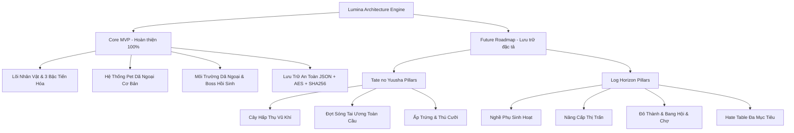

# BÁO CÁO ĐỊNH HƯỚNG PHÁT TRIỂN TƯƠNG LAI & MỞ RỘNG KIẾN TRÚC
## (FUTURE ROADMAP & SYSTEM EXPANSIONS SPECIFICATION)

> **Dự án:** Lumina – 2D Action RPG kết hợp Hệ thống Đồng hành Pet (Living Sandbox ARPG)  
> **Tài liệu phục vụ:** Chương "Hướng Phát Triển Tương Lai & Đánh Giá Đồ Án" – Khóa Luận Tốt Nghiệp  
> **Trạng thái:** Scope Frozen (Đóng băng phạm vi cốt lõi – Lưu trữ đặc tả cho giai đoạn hậu đồ án)  
> **Phiên bản:** v1.0.0-Roadmap  
> **Ngày hoàn thiện:** Tháng 10 Năm 2026  

---

## MỤC LỤC
1. [TỔNG QUAN CHIẾN LƯỢC ĐÓNG BĂNG PHẠM VI (SCOPE FREEZE)](#1-tổng-quan-chiến-lược-đóng-băng-phạm-vi)
2. [TRỤ CỘT I: CƠ CHẾ NÂNG CAO TỪ "SỰ TRỖI DẬY CỦA KHIÊN ANH HÙNG" (TATE NO YUUSHA)](#2-trụ-cột-i-cơ-chế-nâng-cao-từ-tate-no-yuusha)
   - 2.1. Cây Hấp Thụ Vũ Khí (Weapon Absorption Tree)
   - 2.2. Sự Kiện Thế Giới: Đợt Sóng Tai Ương (Waves of Calamity) & Vết Nứt Không Gian
   - 2.3. Hệ Thống Ấp Trứng Thần Thú & Thú Cưỡi Bậc Cao (Mount System)
3. [TRỤ CỘT II: CƠ CHẾ QUẢN TRỊ & XÃ HỘI TỪ "LOG HORIZON"](#3-trụ-cột-ii-cơ-chế-quản-trị--xã-hội-từ-log-horizon)
   - 3.1. Hệ Thống Nghề Phụ Sinh Hoạt Chuyên Sâu (Life Professions)
   - 3.2. Quản Trị & Tái Thiết Thị Trấn (Town Governance & Upgrades - Làng Oakhaven)
   - 3.3. Đô Thành Lumina, Hệ Thống Bang Hội (Guilds) & Sàn Đấu Giá (Auction House)
   - 3.4. Cơ Chế Thù Hận Nhóm Nâng Cao (Group Threat/Hate Table Engine)
4. [LỘ TRÌNH TRIỂN KHAI THEO CÁC GIAI ĐOẠN HẬU DEMO (POST-MVP PHASES)](#4-lộ-trình-triển-khai-theo-các-giai-đoạn-hậu-demo)
5. [ĐÁNH GIÁ TÍNH KHẢ THI KỸ THUẬT & KIẾN TRÚC MỞ RỘNG (TECHNICAL FEASIBILITY)](#5-đánh-giá-tính-khả-thi-kỹ-thuật)

---

## 1. TỔNG QUAN CHIẾN LƯỢC ĐÓNG BĂNG PHẠM VI

Trong quá trình nghiên cứu và phát triển trò chơi Lumina 2D Action RPG, nhóm phát triển đã xây dựng thành công bộ khung logic vững chắc cho 10 Nhánh Class, Hệ thống Pet dã ngoại và Hệ sinh thái Quái vật. Tuy nhiên, việc mở rộng quá nhanh các tính năng phức hợp mang phong cách MMORPG vào giai đoạn hoàn thiện đồ án tiềm ẩn rủi ro:
* **Phân tán trọng tâm kiểm thử**: Giảm độ hoàn thiện của vòng lặp gameplay cốt lõi (Core Combat Loop).
* **Quá tải giao diện & Trải nghiệm người dùng (UX)**: Khiến người chơi mất tập trung vào cơ chế chiến đấu 2D mượt mà.
* **Nguy cơ lỗi dây chuyền**: Các hệ thống kinh tế xã hội và sự kiện thời gian thực đòi hỏi hạ tầng mạng đồng bộ cao.

Do đó, **Chiến lược Đóng băng Phạm vi (Scope Freeze)** được kích hoạt nhằm đưa dự án về bản **Core MVP (Minimal Viable Product)** ổn định 100%, đồng thời lưu trữ toàn bộ các ý tưởng nghiên cứu chuyên sâu dưới đây thành tài liệu đặc tả học thuật cho chương "Hướng Phát Triển Tương Lai".



---

## 2. TRỤ CỘT I: CƠ CHẾ NÂNG CAO TỪ "TATE NO YUUSHA"

### 2.1. Cây Hấp Thụ Vũ Khí (Weapon Absorption Tree)
* **Ý tưởng cốt lõi:** Lấy cảm hứng từ Khiên của anh hùng Naofumi, nhân vật không chỉ nhặt vũ khí có sẵn mà có thể "cho vũ khí nuốt" các bộ phận quái vật (Thịt, Vảy, Vuốt, Răng nanh, Lõi ma lực) để mở khóa các hình thái biến dị mới.
* **Mô hình Dữ liệu Đặc tả (Proposed Data Schema):**
  ```csharp
  [System.Serializable]
  public class WeaponAbsorptionNode
  {
      public string nodeId;
      public string requiredMonsterItemId;
      public int requiredItemCount;
      public StatModifier permanentStatsBonus; // +ATK, +DEF, +Resist
      public string unlockedWeaponFormId;     // Tên dạng vũ khí mở khóa
      public SkillData exclusivePassiveSkill;  // Nội tại gắn liền với dạng vũ khí
      public bool isUnlocked;
  }
  ```
* **Cơ chế Cân bằng (Balancing Philosophy):**
  - Giới hạn hấp thụ mỗi loài quái vật theo ngưỡng cấp bậc (Cap Per Monster Tier).
  - Ngăn ngừa tình trạng người chơi farm lặp quái cấp thấp để tăng chỉ số vô hạn.
  - Phù hợp tích hợp với UI Cây Kỹ Năng (Tree Graph Canvas) tương lai.

### 2.2. Sự Kiện Thế Giới: Đợt Sóng Tai Ương (Waves of Calamity) & Vết Nứt Không Gian
* **Cơ chế vận hành:**
  - Đồng hồ đếm ngược thế giới hiển thị trên bầu trời (Skybox đổi sang màu tím thẫm rực đỏ).
  - Khi đếm ngược về 0: Vết nứt không gian (Dimensional Rift) mở ra tại các tọa độ ngẫu nhiên trên thảo nguyên và rừng rậm.
  - Hàng đàn quái vật dị biến (Calamity Beasts) tràn xuống tấn công hướng về phía Làng Tân Thủ.
* **Điều kiện hoàn thành:**
  - Tiêu diệt Tướng Chỉ Huy của Đợt Sóng (Calamity Boss) trong thời gian giới hạn (15 phút).
  - Thưởng: Rương báu Cổ Đại, Điểm Công Trạng Hiệp Hội và Danh hiệu Đặc biệt.

### 2.3. Hệ Thống Ấp Trứng Thần Thú & Thú Cưỡi Bậc Cao (Mount System)
* **Quy trình:**
  - Nhặt được Trứng Thần Thú từ sào huyệt Boss sâu trong Rừng Rậm.
  - Đặt vào Lồng Ấp (Incubator) tại Trang trại Thú cưng, cung cấp nhiệt lượng và thức ăn.
  - Thần thú nở ra (dạng chim ma thuật như Filo hoặc sói thần), có chỉ số Thân Thiết (Bond).
* **Tính năng Cưỡi (Phím tắt [G]):**
  - Tăng 60% tốc độ di chuyển trên bản đồ thế giới mở.
  - Cho phép vừa di chuyển vừa tung kỹ năng càn quét (Mounted Combat).

---

## 3. TRỤ CỘT II: CƠ CHẾ QUẢN TRỊ & XÃ HỘI TỪ "LOG HORIZON"

### 3.1. Hệ Thống Nghề Phụ Sinh Hoạt Chuyên Sâu (Life Professions)
* **Phân lớp nghề nghiệp:**
  - **Đầu Bếp (Chef):** Chế biến thịt thú và thảo mộc thành món ăn cao cấp cung cấp buff kéo dài 30 phút (tăng kháng nguyên tố, hồi phục tự nhiên, tăng tỷ lệ rớt đồ).
  - **Thợ Săn Bẫy (Trapper):** Đặt bẫy giữ chân quái vật dã ngoại, tăng 50% tỷ lệ bắt Pet thành công đối với quái hiếm.
  - **Học Giả / Pháp Trận Sư (Enchanter):** Khắc ấn chú ma thuật lên trang bị và chế tạo cuộn dịch chuyển tức thời.

### 3.2. Quản Trị & Tái Thiết Thị Trấn (Town Governance & Upgrades)
* **Khai thác tài nguyên xây dựng Làng Oakhaven:**
  - Người chơi quyên góp Gỗ mục, Đá khoáng, Vàng tích lũy cho Trưởng Làng.
  - Nâng cấp cơ sở hạ tầng:
    * **Tháp Canh Ma Thuật (Level 1–3):** Tự động bắn tỉa quái vật áp sát ranh giới an toàn.
    * **Lò Rèn Công Cộng:** Tăng tỷ lệ cường hóa thành công trang bị từ 50% lên 80%.
    * **Vườn Dược Liệu Tự Động:** Sản sinh thảo mộc thụ động mỗi 60 phút.

### 3.3. Đô Thành Lumina, Hệ Thống Bang Hội & Sàn Đấu Giá
* **Đại Đô Thành Lumina:**
  - Trung tâm kinh tế văn hóa kết nối các vùng đất hoang dã.
  - Nơi diễn ra các hoạt động giao thương giữa người chơi (P2P Trading).
* **Sàn Đấu Giá (Auction House) & Kinh Tế Mở:**
  - Cho phép niêm yết vật phẩm quý hiếm, trứng thú và trang bị chế tạo.
  - Hệ thống tính phí giao dịch nhằm cân bằng lượng vàng lưu thông trong game.

### 3.4. Cơ Chế Thù Hận Nhóm Nâng Cao (Group Threat/Hate Table Engine)
* **Thuật toán Hate Table:**
  $$\text{Hate} = (\text{DamageDealt} \times \text{Multiplier}) + (\text{HealingDone} \times 0.5) + \text{TauntValue}$$
* **Hành vi Boss:**
  - Luôn nhắm vào mục tiêu có điểm Hate cao nhất.
  - Kỹ năng quét đuôi/phản đòn đối với mục tiêu đứng phía sau có Hate thứ nhì.
  - Cho phép xây dựng đội hình chuẩn MMO: Tanker gom quái, Healer giữ máu, DPS xả chiêu.

---

## 4. LỘ TRÌNH TRIỂN KHAI THEO CÁC GIAI ĐOẠN HẬU DEMO

| Giai Đoạn | Tên Giai Đoạn | Nội Dung Trọng Tâm | Thời Gian Dự Kiến |
| :--- | :--- | :--- | :--- |
| **Phase 1** | **Bản Core MVP (Hiện Tại)** | Hoàn thiện 4 trụ cột cơ bản, 0 lỗi biên dịch, Scene MainGame chạy mượt mà 60 FPS | **Tháng 10/2026 (Đã đóng băng)** |
| **Phase 2** | **Bản Mở Rộng Dã Ngoại (Wilderness Expansion)** | Bổ sung Cây Hấp Thụ Vũ Khí cơ bản, thêm 2 khu vực dã ngoại mới (Đầm Lầy & Núi Lửa) | Q1 / 2027 |
| **Phase 3** | **Bản Thần Thú & Thú Cưỡi (Mount & Bond)** | Mở khóa Hệ thống Ấp Trứng, Thú Cưỡi [G], giao diện Quản lý Trại Pet | Q2 / 2027 |
| **Phase 4** | **Bản Xã Hội & Sự Kiện (Living World & Events)** | Tích hợp Đợt Sóng Tai Ương, Nâng cấp Làng Tân Thủ, Nghề Đầu Bếp | Q3 / 2027 |
| **Phase 5** | **Bản Đô Thành Lumina (Metropolis MMO)** | Mở cổng Đô Thành Lumina, Hệ thống Bang Hội, Đấu Giá và Multiplayer Coop | Q4 / 2027 |

---

## 5. ĐÁNH GIÁ TÍNH KHẢ THI KỸ THUẬT

1. **Khả năng tương thích mã nguồn hiện tại:**
   - Bộ khung `EventBus.cs` đã được thiết kế sẵn các sự kiện toàn cầu, dễ dàng kết nối các sự kiện thế giới (`OnWaveStarted`, `OnTownUpgraded`) mà không phá vỡ logic cũ.
   - Hệ thống ScriptableObject (`EnemyData`, `PetData`, `CharacterClassData`) tuân thủ cấu trúc dữ liệu mô-đun hóa, hỗ trợ mở rộng thêm trường dữ liệu trong tương lai.
2. **Hiệu năng & Tối ưu hóa:**
   - Việc tạm hoãn các hệ thống mô phỏng phức tạp giúp bản build hiện tại duy trì tải bộ nhớ < 500 MB và ổn định 60 FPS trên cả thiết bị tầm trung.
3. **Giá trị học thuật:**
   - Tài liệu này đóng vai trò là cơ sở luận cứ chứng minh tầm nhìn kiến trúc dài hạn của đồ án tốt nghiệp, thể hiện khả năng quy hoạch lộ trình công nghệ (Product Roadmap Planning) chuyên nghiệp.
