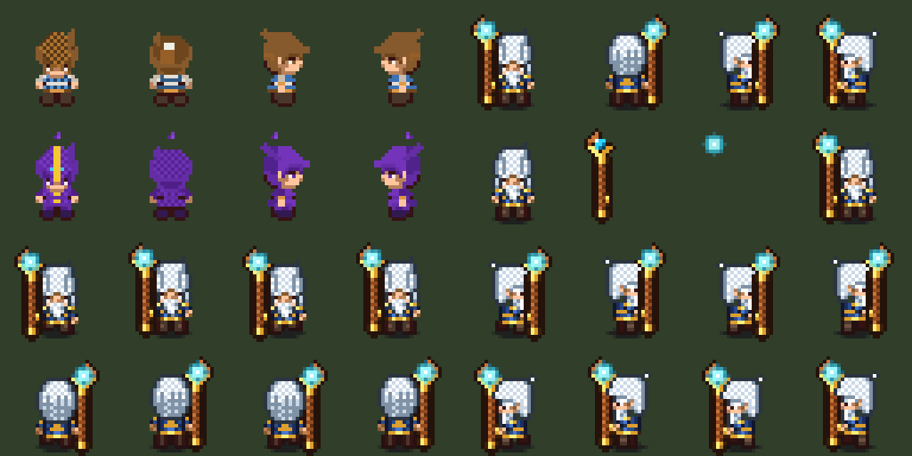

# Báo Cáo Kỹ Thuật Phần 1/3: `PixelArtShadingHelper` & Trưởng Làng Eldrin (`NPC_VillageElder.prefab`)

> [!IMPORTANT]
> Toàn bộ tài nguyên hình ảnh được vẽ bằng code (`art_source: "code"`, code-drawn, no image model) trên lưới chuẩn $32 \times 32\text{ px}$ ($\text{PPU} = 16$, `FilterMode.Point`, `SpriteRenderer.color = Color.white`), đồng bộ 100% giải phẫu Chibi với **Player Class** ([player_novice_4direction.png](../Assets/Sprites/player_novice_4direction.png)).

---

## 1. Bộ Hàm Lõi `PixelArtShadingHelper` (Đầy Đủ Không Viết Tắt)

- **File C# Runtime / Editor:** [PixelArtShadingHelper.cs](../Assets/Scripts/Visuals/PixelArtShadingHelper.cs)
- **File Python Generator Core:** [pixel_art_shading_helper.py](../Assets/Sprites/NPCs/pixel_art_shading_helper.py)

### Các tiêu chuẩn kỹ thuật đã áp dụng:
1. **Bảng màu 4 sắc độ (`ColorRamp4`: `Outline` $\rightarrow$ `Shadow` $\rightarrow$ `Base` $\rightarrow$ `Highlight`) & Đan caro Dithering:**
   - Loại bỏ hoàn toàn `FillRect` đơn sắc.
   - Mọi vùng chất liệu (tóc bạc, da Chibi, áo choàng chàm, viền vàng hoàng kim, gỗ sồi, ngọc lam) đều đi qua hàm lấy mẫu 4 sắc độ kết hợp đan caro `(x + y) % 2 == 0` giống hệt mũ/tóc của Player Class.
2. **Giải phẫu Chibi $32 \times 32$ ($\text{PPU} = 16$, `SpriteRenderer.color = Color.white`):**
   - **Đầu to Chibi (`Y = 8..17`, rộng $12\text{ px}$ tại `X = 10..21`):** Đổ bóng vòm đầu đan caro + chia rãnh từng lọn tóc bạc.
   - **Mắt có điểm sáng trắng (`Y = 18..19`):** Con ngươi tối `#361313` ở hàng `Y = 18` và **điểm sáng trắng `#F7EFEB`** ở hàng `Y = 19` (`X = 13` và `X = 18`) khớp 1:1 với Player Class.
   - **2 tay tách nhẹ 2 bên hông (`X = 10..11` và `X = 20..21`, `Y = 21..24`):** Có đường viền tối $1\text{ px}$ tại khe nách (`X = 12` và `X = 19`, `Y = 23`) tách rõ tay khỏi thân áo.
   - **2 chân tách rõ (`X = 12..14` và `X = 17..19`, `Y = 26..29`):** Có khe hở $2\text{ px}$ ở giữa (`X = 15..16`), đế ủng tối màu tại `Y = 29` và bắt buộc có bóng đen mờ hình elip (`DropShadow`) dưới bàn chân (`Y = 28..30`).
3. **Đồng bộ lưới Pixel (`No Mixels`):**
   - Đạo cụ vẽ trực tiếp trên cùng khung $32 \times 32\text{ px}$ ($\text{PPU} = 16$) với thân gậy dày $2\text{ px}$ có viền tối bao quanh, đặt `localPosition = Vector3.zero` để khớp tuyệt đối vào tọa độ bàn tay nhân vật.

---

## 2. Hoàn Thiện NPC Số 1: Trưởng Làng Eldrin ([NPC_VillageElder.prefab](../Assets/Prefabs/ForestPrototype/NPC_VillageElder.prefab))

- **Script sinh Sprite 4 hướng:** [generate_eldrin_sprites.py](../Assets/Sprites/NPCs/generate_eldrin_sprites.py)
- **Thư mục Sprite Modular:** `Assets/Sprites/NPCs/Modular/Eldrin/`
- **Cấu trúc Hierarchy & Components trên [NPC_VillageElder.prefab](../Assets/Prefabs/ForestPrototype/NPC_VillageElder.prefab):**
  - `NPC_VillageElder` (Root: `DirectionalWalkAnimator` đủ 4 hướng `Front`/`Back`/`Side`/`Left`, `NPCModularCharacter2D`, `SpriteRenderer.color = Color.white`, `m_LocalScale = (0.75, 0.75, 1)` tại $\text{PPU} = 16$ $\rightarrow$ khớp 1:1 kích thước thế giới $1.03125\text{ units}$ với Player Class).
    - `Prop_ElderStaff` ([NPCModularProp.cs](../Assets/Scripts/Town/NPCModularProp.cs)):
      - Gắn đủ 4 hướng `spriteFront`, `spriteBack`, `spriteSide`, `spriteLeft`.
      - Tự động đảo `SortingOrder` theo hướng nhìn (`+1` khi nhìn `Down`/`Right`, `-1` khi nhìn `Up`/`Left`).
      - Tự động nhún $1\text{ px}$ (`-1/16 unit`) đồng bộ theo đúng frame bước chân của `DirectionalWalkAnimator` (`syncWithWalkStepBob = true`).
      - `Prop_OrbGlow` ([EldrinStaffOrbGlow.cs](../Assets/Scripts/Town/EldrinStaffOrbGlow.cs)):
        - Tách riêng lớp hào quang viên ngọc lam 4 hướng (`glowFront`, `glowBack`, `glowSide`, `glowLeft`), khóa vị trí `localPosition = Vector3.zero` trùng khít tâm viên ngọc trên đỉnh trượng và phát sáng nhấp nháy (`Glow/Pulse`) theo hàm sóng $\sin$.
